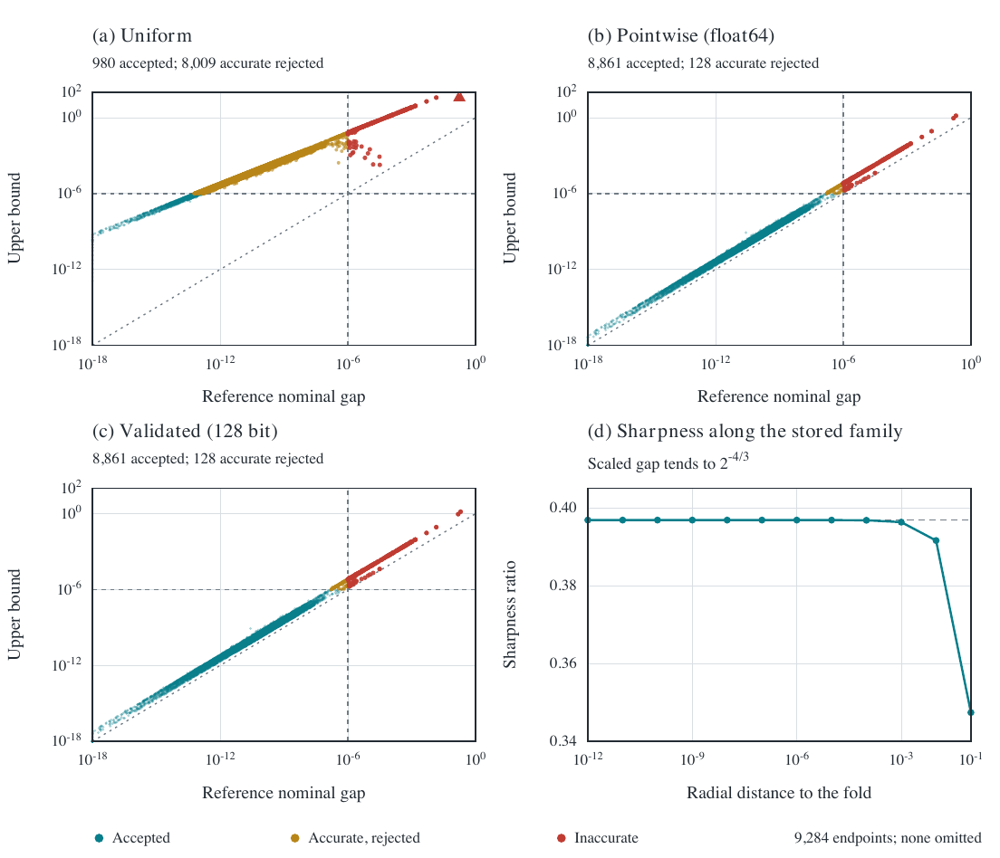
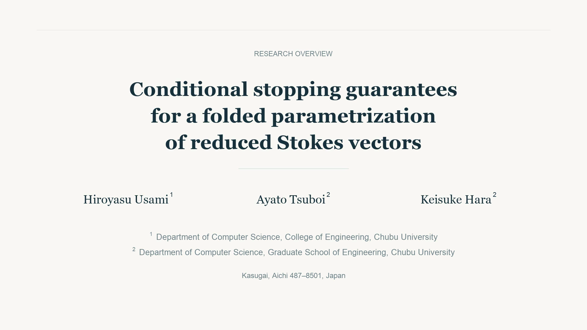

# Conditional stopping guarantees for a folded parametrization of reduced Stokes vectors

**Hiroyasu Usami · Ayato Tsuboi · Keisuke Hara**<br>
Chubu University, Japan · Private author-review repository · Working manuscript

A small gradient in **head coordinates** need not control the objective gap in **physical Stokes coordinates**. This study connects the information lost by a folded map from $(a,w)$ to $(I,Q,U)$ to a conditional stopping certificate. It supplies the recovery identities, their assumptions, and fixed numerical records against which the implementation can be checked.

[**Read the arXiv-generated paper**](paper/arxiv.pdf) · [Exact source ZIP](manuscript/arxiv/stokes-arxiv-source.zip) · [Evidence and code](docs/RESULTS_MAP.md) · [Reproduce](#start-with-an-integrity-check) · [2-minute overview](#watch-the-research-overview)

The primary PDF is the **49-page arXiv-generated draft**, including the complete Supplementary Information. It has not yet been submitted or announced. [Source and build instructions](manuscript/arxiv/) · [Separate journal-format copies](paper/README.md).


## Two results, two scopes

| Result | What it establishes | Conditions and location |
| --- | --- | --- |
| **Recover the lost information** | At the fold, first derivatives and **one signed radial second derivative** determine the full physical gradient. | Any $C^2$ physical objective; stationary or nonstationary points. **Proposition 1**, Figure 2. |
| **Certify a stopping decision** | On the bounded-intensity inner sheet, specified derivative tests give an explicit physical objective-gap bound with sharp tolerance orders $\varepsilon^{4/3}+\nu^2$. | Strong convexity, the stated geometry, and derivative-error conditions. **Theorem 7**, Figure 1. |

The second derivative is taken along the head's radial direction, at fixed intensity coordinate and polarization direction. It is a derivative of the **composite objective**, rather than the curvature of the map drawn above. Recovery at the exact fold and finite-tolerance stopping throughout the inner sheet are distinct statements.

The gap $\Delta(s)$ is measured against the best physically feasible objective value:

```math
\Delta(s) \leq \frac{52(\bar I L)^{2/3}}{\mu}\,\varepsilon^{4/3}
+ \frac{3}{\mu}\,\nu^2.
```

<details>
<summary><strong>Assumptions and interpretation of the bound</strong></summary>

- The physical objective is $C^2$ and $\mu$-strongly convex.
- The evaluated coordinates satisfy $0<I\leq\bar I$ and $0\leq r\leq1$, where $r=\|w\|$.
- $\varepsilon\geq0$ bounds the normalized first derivatives, with $\varepsilon\leq\bar I L/8$.
- Choose $L\geq\mu$. For $r\geq1/2$, $L$ also bounds the physical radial curvature at the evaluated point, and $\nu\geq0$ bounds the negative part of the normalized radial curvature. No radial-curvature observation is required for $r<1/2$.

The coefficient 52 is conservative; the two tolerance orders are sharp. See **Theorem 7** in the [main paper](paper/arxiv.pdf) for the complete statement and the [stopping-bound implementation](theory/stopping_guarantee/) for the pointwise formula and derivative-error budgets.

</details>

## What the fixed records show

The outward-rounded **pointwise** certificate was evaluated on all **9,284 stored endpoints** for the nominal ideal four-analyzer quadratic, at an absolute objective-gap target of $10^{-6}$.

Outer-sheet endpoints are represented by paired inner coordinates with the same physical output before the derivatives are evaluated.

| At 128 fractional bits | Endpoints | Inspect the evidence |
| --- | ---: | --- |
| Certified within the nominal gap target | **8,861 / 9,284** | [Interval summary](theory/validated_stopping/results/SUMMARY.json) |
| Historical false successes rejected | **295 / 295** | [Endpoint records](theory/validated_stopping/results/ENDPOINTS.json) |
| Accurate by the reference, but not certified | **128** | [Interval study and definitions](theory/validated_stopping/README.md) |

The 423 rejected endpoints include the 295 inaccurate endpoints and 128 accurate endpoints. A failure to certify therefore does **not** establish inaccuracy. On the same endpoint set, the coarser uniform bound certifies **980** endpoints. Both bounds reject all 295 historical false successes.

<details>
<summary><strong>Inspect the bound comparison — manuscript Figure 1</strong></summary>

[](latex/images/stopping_certification.pdf)

The pointwise and interval bounds certify more of the accurate endpoints than the uniform bound. No endpoint is omitted. The lower-right panel is a **separate deterministic sharpness family**, not another sample of the endpoint audit. [Open the vector figure](latex/images/stopping_certification.pdf).

</details>

The stored interval pass uses **52 scalar curvature evaluations** and forms no full head Hessian. Timings depend on the recorded implementation; direct physical solvers are cheaper on the tested quadratics. These are stopping audits for a specified nominal objective, rather than claims of a faster general-purpose solver.

Other retained findings matter to the interpretation: the fixed local fold gate misses the 295 false successes in the selected released-observation warm starts, and 20 fixed shared-network fits contain no saved near-fold negative-curvature candidates. The [evidence map](docs/RESULTS_MAP.md) connects these findings, the positive results, and the repair controls to their source files.

## Choose a reading path

| Your question | Recommended path |
| --- | --- |
| **What is the main guarantee?** | [Main paper](paper/arxiv.pdf): Theorem 7 and Figure 1; then the exact conditions above. |
| **Why are first derivatives insufficient?** | [Main paper](paper/arxiv.pdf): Proposition 1 and Figure 2; [Supplement](paper/supplement.pdf) for proofs. |
| **Where did a reported number come from?** | [Result-to-file map](docs/RESULTS_MAP.md), then the linked summaries and endpoint records. |
| **How can I check or reproduce it?** | Integrity check below, then the study-specific [reproduction guide](docs/REPRODUCING.md). |

[Combined paper and supplement](paper/complete.pdf) · [Data sources and redistribution limits](docs/THIRD_PARTY.md)

## Start with an integrity check

From the repository root, using Python's standard library:

```sh
python3 validate_package.py
```

This checks the file manifest, preserved scientific records, and Python syntax. It does not train a model, download data, or rerun an experiment.

To evaluate one nominal interval certificate:

```sh
python3 theory/validated_stopping/cli.py --x 0 1 0 --y 1 .5 0 .5
```

This example is a folded optimum. The output includes the exact integer upper bound and the acceptance decision. [Input and output conventions](theory/validated_stopping/README.md) explain its domain and interpretation.

For a complete replay, use the [reproduction guide](docs/REPRODUCING.md). It separates the recorded environments and identifies which commands write outputs. Use fresh output directories or a separate working copy, and preserve the supplied reference records. A replay is compared with the saved scientific outcomes; variable PDF metadata and implementation-specific timings are not substitutes for that comparison.

## Scope and limits

- **Physical model:** $(I,Q,U)$ includes partial linear polarization. Circular polarization $V$ is outside the model.
- **Conditional certificate:** strong convexity, the specified inner-sheet geometry, and the derivative-error conditions are part of the guarantee.
- **Nominal accuracy:** the certificate bounds optimization error for the stated objective. Noise-free Stokes error and uncertain instrument calibration require additional models.
- **Fixed observations:** selected endpoints and dependent continuation histories do not estimate population failure rates.
- **Head derivatives:** a small gradient in arbitrary shared neural-network parameters does not by itself establish the required head-derivative conditions.

## Watch the research overview

[](media/stokes-conditional-stopping.mp4)

[**Open or download the MP4**](media/stokes-conditional-stopping.mp4) · [English captions](media/stokes-conditional-stopping.en.srt)

2 min 6 sec · 1080p · silent, with on-screen explanations and author names. No portrait photographs. GitHub may offer the file for download rather than play it inline.

<details>
<summary><strong>Browse the repository by directory</strong></summary>

| Directory | Contents |
| --- | --- |
| [`paper/`](paper/) | Primary arXiv-generated draft and separate journal-format reader copies |
| [`manuscript/`](manuscript/) | Exact arXiv source bundle and separate journal-format TeX sources |
| [`theory/`](theory/) | Stopping bounds, exact interval arithmetic, and frozen results |
| [`application/`](application/) | Fresnel sequences, selected observations, and coordinate-repair studies |
| [`repro/`](repro/) | Recovery checks, figure generators, and saved network/warm-start records |
| [`examples/`](examples/) | Small physical-gradient recovery example |
| [`verification/`](verification/) | Numerical core used by the application replays |
| [`docs/`](docs/) | Evidence index, environments, numerical conventions, and attribution |
| [`media/`](media/) | Overview video, captions, and README visuals |

</details>

## Integrity, citation, and reuse

[`MANIFEST.sha256`](MANIFEST.sha256) covers this repository snapshot; [`FROZEN_FILES.sha256`](FROZEN_FILES.sha256) identifies the unchanged scientific files. Figure generators write to `latex/images/`. The exact arXiv inputs are in `manuscript/arxiv/images/`; journal-format inputs are in `manuscript/source/images/`.

Use [`CITATION.cff`](CITATION.cff) for author and title metadata. When reporting a reproduction, identify the repository commit, command, environment, and relevant file hashes.

Original author-contributed code and software documentation use the [MIT License](LICENSE). Manuscripts, figures, and selected third-party observations are outside that code licence. Full original datasets and model weights are not included. Consult the [source and rights notes](docs/THIRD_PARTY.md) before using external data. Access to this author-review repository is restricted to invited collaborators and reviewers.
