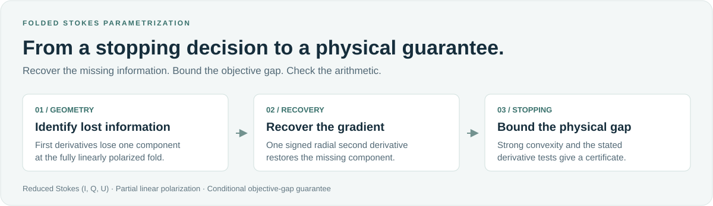

# Conditional stopping guarantees for a folded parametrization of reduced Stokes vectors

**Hiroyasu Usami · Ayato Tsuboi · Keisuke Hara**<br>
Chubu University, Japan

**An optimizer says “converged.” What does that certify in physical coordinates?**

A small gradient in optimization coordinates can conceal a nonzero physical objective gap. We study this problem for a smooth, folded parametrization of reduced Stokes vectors $(I,Q,U)$, including partial linear polarization. At the fully linearly polarized boundary, first derivatives lose one component of the physical gradient. A signed radial second derivative recovers it.

[**Read the paper**](paper/main.pdf) · [Supplementary Information](paper/supplement.pdf) · [Combined PDF](paper/complete.pdf) · [Watch the overview](#watch-the-research-overview) · [Reproduce](#start-with-a-small-check)



> Private author-review repository. Access is restricted to invited collaborators and reviewers; the accompanying manuscript is a working draft.

## Why, how, and what

| Question | Contribution |
| --- | --- |
| **Why can a stopping decision be misleading?** | At the fold, first-order information in parametrization coordinates does not determine the full physical gradient. |
| **How do we recover the missing information?** | One signed radial second derivative gives an exact recovery identity at the fold, without stationarity or knowledge of the physical Hessian. |
| **What can we certify?** | For strongly convex physical objectives on the bounded-intensity inner sheet, normalized first derivatives and a radial lower-curvature test give an explicit objective-gap bound. |

The uniform theorem has the form

```math
\Delta(s) \leq \frac{52(\bar I L)^{2/3}}{\mu}\,\varepsilon^{4/3}
+ \frac{3}{\mu}\,\nu^2.
```

Here $\Delta(s)$ is the gap to the best physically feasible objective value, $\mu$ is the strong-convexity constant, $\bar I$ bounds intensity, and $L$ bounds physical radial curvature. The objective is $C^2$, with $L\geq\mu>0$. The normalized first-derivative tolerance is $\varepsilon\geq0$; $\nu\geq0$ bounds negative normalized radial curvature. The theorem also requires $0<I\leq\bar I$, $0\leq r\leq1$, and $\varepsilon\leq\bar I L/8$. The radial curvature test is needed only for $r\geq1/2$. The two tolerance orders are sharp; the coefficient 52 is conservative.

See **Theorem 7** in the [paper](paper/main.pdf) for the complete statement, and [the stopping-bound implementation](theory/stopping_guarantee/) for the pointwise formula and input-error model.

## Results at a glance

The outward-rounded implementation evaluates a tighter **pointwise** bound for the nominal ideal four-analyzer quadratic. These outcomes use the same **9,284 stored endpoints** and an absolute nominal objective-gap target of $10^{-6}$.

| Outcome | Stored result | Evidence |
| --- | ---: | --- |
| Endpoints certified at 128 fractional bits | **8,861** | [Interval results](theory/validated_stopping/results/SUMMARY.json) |
| Historical false successes rejected | **295 of 295** | [Endpoint records](theory/validated_stopping/results/ENDPOINTS.json) |
| Accurate endpoints that remain uncertified | **128** | [Interval study](theory/validated_stopping/README.md) |
| Endpoints accepted by the coarser uniform bound | **980** | [Stopping-bound study](theory/stopping_guarantee/README.md) |

[](latex/images/stopping_certification.pdf)

*Figure 1 from the manuscript. The validated pointwise bound rejects every inaccurate endpoint in this fixed set, while retaining more accurate endpoints than the uniform bound. The lower-right panel is a separate deterministic sharpness family. [Open the vector figure](latex/images/stopping_certification.pdf).*

At 128 fractional bits, the recorded complete pass takes **7.32 seconds**, includes **52 scalar curvature evaluations**, and forms no full head Hessian. This timing is specific to the recorded run and excludes the separate reference computation. Direct physical solvers are cheaper on the tested quadratics.

The application studies also retain the limits of local fold diagnosis: the fixed local gate misses the 295 false successes in the selected released-observation warm starts. Twenty fixed shared-network fits contain no saved near-fold negative-curvature candidates. [Follow each claim to its evidence](docs/RESULTS_MAP.md).

## Watch the research overview

[](media/stokes-conditional-stopping.mp4)

[**Open or download the video**](media/stokes-conditional-stopping.mp4) · [English captions](media/stokes-conditional-stopping.en.srt)

2 min 6 sec · 1080p · silent, with on-screen explanations. The overview includes the authors' names and affiliations, without portrait photographs. GitHub may open the video file in its viewer or offer a download.

## Choose your starting point

| You want to… | Start here |
| --- | --- |
| Understand the main guarantee | [Main paper](paper/main.pdf): Theorem 7 and Figure 1 |
| Understand the geometric obstruction | [Main paper](paper/main.pdf): Proposition 1 and Figure 2 |
| Check every proof and numerical protocol | [Supplementary Information](paper/supplement.pdf) |
| Find the source and records behind a result | [Result-to-file map](docs/RESULTS_MAP.md) |
| Replay a result in its recorded environment | [Reproduction guide](docs/REPRODUCING.md) |
| Inspect the exact interval acceptance rule | [Interval implementation and scope](theory/validated_stopping/README.md) |
| Locate data sources and redistribution limits | [Source and rights notes](docs/THIRD_PARTY.md) |

## Start with a small check

Run these commands from the repository root. The first two need only Python's standard library and do not run training or download data.

**1. Check the supplied files and Python syntax.**

```sh
python3 validate_package.py
```

This verifies the package manifest, unchanged scientific records, and Python source syntax. It does not rerun experiments.

**2. Evaluate one interval certificate.**

```sh
python3 theory/validated_stopping/cli.py --x 0 1 0 --y 1 .5 0 .5
```

The example evaluates a folded optimum. Its JSON output includes the exact integer upper bound and acceptance decision. [Read the input and output conventions](theory/validated_stopping/README.md).

**3. Replay the stored interval study.**

Choose a new or empty output directory:

```sh
python3 theory/validated_stopping/replay.py \
  --output /tmp/stokes-interval-replay
```

The replay compares deterministic endpoint, reference, and stress records. Timing and environment fields are excluded from the scientific comparison. Other studies use separately recorded numerical environments; follow [the reproduction guide](docs/REPRODUCING.md) before running them.

<details>
<summary><strong>Optional: try the physical-gradient recovery example</strong></summary>

The example compares recovery routes at radii 0.99, 1.00, and 1.01. Install the pinned numerical dependencies in an isolated environment:

```sh
python3 -m venv .venv
.venv/bin/python -m pip install -r repro/requirements.txt
.venv/bin/python examples/recover_gradient.py
```

See [recorded environments](docs/REPRODUCING.md#recorded-environments) for the Python version and environments used by other studies.

</details>

## Scope of the claims

- **Reduced Stokes model:** $(I,Q,U)$ includes partial linear polarization; circular polarization $V$ is outside the model.
- **Conditional guarantee:** strong convexity, the stated geometry, model constants, and derivative-error assumptions are part of the theorem.
- **Nominal objective:** the numerical certificate bounds optimization error for the specified model. It does not bound error to noise-free Stokes truth or establish unknown instrument calibration.
- **Fixed observations:** selected endpoints and dependent continuation histories do not estimate population failure rates.
- **Head coordinates:** the results do not imply the same guarantee for arbitrary shared neural-network parameters. Direct physical methods remain explicit controls.

## Repository map

| Directory | Contents |
| --- | --- |
| [`paper/`](paper/) | Main, supplementary, and combined reader PDFs |
| [`manuscript/`](manuscript/) | Matching TeX sources, figures, class, and build instructions |
| [`theory/`](theory/) | Stopping bounds, exact interval arithmetic, and frozen results |
| [`application/`](application/) | Fresnel sequences, selected observations, and coordinate-repair studies |
| [`repro/`](repro/) | Recovery checks, figure generators, and saved network/warm-start records |
| [`examples/`](examples/) | Small physical-gradient recovery example |
| [`verification/`](verification/) | Numerical core used by the application replays |
| [`docs/`](docs/) | Evidence index, environments, numerical conventions, and attribution |
| [`media/`](media/) | Research overview, captions, and README visuals |

## Integrity, citation, and reuse

[`MANIFEST.sha256`](MANIFEST.sha256) covers this repository snapshot. [`FROZEN_FILES.sha256`](FROZEN_FILES.sha256) identifies unchanged scientific files carried into it. Preserve the supplied reference records when regenerating outputs. Figure generators write to `latex/images/`; manuscript inputs are separate in `manuscript/source/images/`.

Use [`CITATION.cff`](CITATION.cff) for author and title metadata. When reporting a reproduction, identify the repository commit, command, environment, and relevant file hashes.

Original author-contributed code and software documentation use the [MIT License](LICENSE). Manuscripts, figures, and selected third-party observations are outside that code licence. Full original datasets and model weights are not included. Read [the source and rights notes](docs/THIRD_PARTY.md) before using external data.
