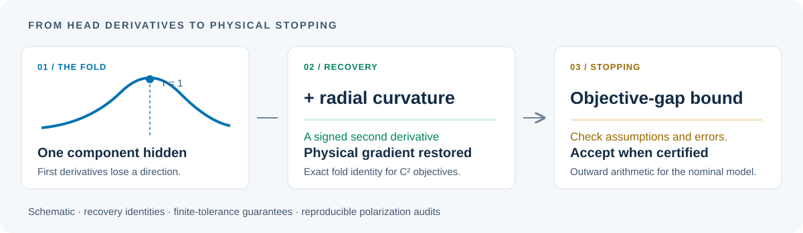

# Stokes Gradient Recovery

### Physical Gradient Recovery and Stopping Guarantees for a Folded Stokes Parametrization

Hiroyasu Usami · Ayato Tsuboi · Keisuke Hara

**A small gradient through a physicality-preserving output map can hide an inaccurate physical solution.**

This repository accompanies the [manuscript](paper/main.pdf) and [supplement](paper/supplement.pdf). It provides recovery formulas, conditional stopping bounds, an outward-interval implementation, and reproducible polarization-fitting experiments.

[Main results](#main-results) · [Quickstart](#quickstart) · [Reproduce](#reproduce-the-paper) · [Code and data](#code-and-data) · [Citation](#citation)



Author preprint: [PDF](paper/main.pdf) · [Full paper and supplement](paper/complete.pdf). We plan to submit to arXiv in November 2026; the submitting author has reached the current [monthly new-submission limit](https://info.arxiv.org/help/moderation/index.html#submission-rate).

## The question

The rational Stokes head maps unconstrained coordinates into physically admissible linear-polarization states:

$$
T(a,w)=I(a)\left(1,\frac{2w}{1+\lVert w\rVert^2}\right).
$$

Here $I(a)>0$ is a regular intensity coordinate with $I'(a)\ne0$.

At full polarization, $\lVert w\rVert=1$, its Jacobian loses one direction. First derivatives of the composite objective then leave one physical-gradient component undetermined. **One signed radial second derivative recovers that component**, even at a nonstationary point and without knowing the physical Hessian.

The formulas and stopping rules assess endpoints in an existing Stokes-head fitting pipeline. Direct physical differentiation and physical solvers provide controls when those oracles are available.

## Main results

| Result | Conditions and meaning | Paper |
| --- | --- | --- |
| **Recovery at the fold** | Any $C^2$ physical objective, known positive intensity and head geometry; one signed radial curvature restores the missing gradient component. | Proposition 1 |
| **Recovery near the fold** | Mixed-scalar and vector-HVP routes use their specified physical-curvature inputs, with explicit input-error gains. | Propositions 2–3, Corollary 4 |
| **Finite-tolerance stopping** | For strongly convex physical objectives on the bounded-intensity inner sheet, normalized first derivatives and one radial lower-curvature test give an explicit gap bound of order $\varepsilon^{4/3}+\nu^2$. Both orders are sharp. | Theorem 7, Supplement S20 |
| **Outward interval evaluation** | For the nominal ideal analyzer quadratic, exact dyadic comparisons certify a gap at most $10^{-6}$ at 8,861 of 9,284 stored endpoints at 64–256 fractional bits, with 52 scalar curvature evaluations. | Supplement S21 |

The stopping bounds include model, chart, intensity, and error-budget assumptions. The interval implementation encloses the specified nominal model; instrument uncertainty requires its own model and enclosures.

## Quickstart

### Recover a physical gradient

The numerical example uses the pinned NumPy/SciPy environment. Run from the repository root:

```sh
git clone https://github.com/usamihiroyasu/stokes-gradient-recovery.git
cd stokes-gradient-recovery
python3 -m venv .venv
.venv/bin/python -m pip install -r repro/requirements.txt
.venv/bin/python examples/recover_gradient.py
```

The example compares the available inverse formulas with a known quadratic physical gradient at radii 0.99, 1, and 1.01. Successful checks print a small reconstruction error for each applicable route.

### Evaluate a certified nominal stopping bound

This separate implementation uses **only the Python standard library**:

```sh
python3 theory/validated_stopping/cli.py --x 0 1 0 --y 1 .5 0 .5
```

The default uses 128 fractional bits. The JSON output gives the exact integer endpoint of the bound and the acceptance decision. See the [interval implementation guide](theory/validated_stopping/README.md) for output semantics and domain.

## Reproduce the paper

The [reproduction guide](docs/REPRODUCING.md) maps commands to formulas, figures, recorded environments, and saved results. The original recovery checks and later application experiments have separate pinned environments. Start with the part you need:

| Study | Entrypoint or guide | Evidence |
| --- | --- | --- |
| Recovery identities and perturbation gains | [Numerical checks](docs/REPRODUCING.md#recovery-and-sensitivity) | Nonquadratic objectives, finite radius offsets, and prescribed input perturbations |
| Sequential warm starts | [Protocol and replay](docs/WARM_START.md) | Native status, false successes, and curvature-triggered restarts |
| Fresnel reflection | [Simulation](application/fresnel_sequence/README.md) | 24 fixed sequences, 984 frames |
| Released polarization observations | [Data audit](application/real_data/README.md) | 37,136 fits from DeepSfP, PolarNS means, and PolarBurstSR |
| Coordinate repair | [Paired endpoint audit](application/chart_repair/README.md) | All 9,284 historical warm endpoints retained |
| Uniform stopping theorem | [Theorem checks](theory/stopping_guarantee/README.md) | Explicit constants, sharp examples, and domain counterexamples |
| Validated nominal stopping | [Standard-library replay](theory/validated_stopping/README.md) | Exact endpoint records at 32, 64, 128, and 256 fractional bits |

For example, the interval replay preserves the supplied records and writes to a fresh directory:

```sh
python3 theory/validated_stopping/replay.py --output /tmp/stokes-validated-replay
```

### What the experiments show

| Evaluation | Recorded outcome |
| --- | --- |
| Controlled two-frame fits | At zero angle change and tolerance $10^{-6}$, the local gate detects all 28 SciPy false successes. Coverage is partial at looser tolerances. |
| Fresnel sequences | The local gate detects all 16 false successes in the fixed grid. |
| Released-observation warm starts | All 295 inaccurate native successes lie outside the fixed local gate's detection; the physical gap bound rejects all 295. |
| Paired repair | Coordinate repair corrects 249 of those 295 endpoints; standard physical fallback corrects the remaining 46. |
| Direct physical controls | Direct physical methods are cheaper in the tested implementation. |
| Shared-network fitting | None of the saved checkpoints in 20 fixed fits meets the near-fold negative-curvature test. |

These are stopping audits for the stated objectives. Observation selections, native statuses, query accounting, timing scope, and static-versus-temporal interpretations are retained in the individual protocols.

## Code and data

| Directory | Contents |
| --- | --- |
| [`examples/`](examples/) | Small physical-gradient recovery example |
| [`repro/`](repro/) | Identity checks, figure generators, shared-network records, and warm-start experiments |
| [`application/`](application/) | Fresnel simulation, released observations, and coordinate repair |
| [`theory/`](theory/) | Finite-tolerance bounds and outward interval arithmetic |
| [`latex/`](latex/) | Editable main paper and supplement |
| [`paper/`](paper/) | Main paper, supplement, and combined PDF |
| [`docs/`](docs/) | Reproduction instructions, numerical conventions, and source attribution |

Selected numerical observations, coordinates, and source checksums support replay of the released-data audit. Full original images remain with the [DeepSfP](https://github.com/UCLA-VMG/DeepSfP/blob/master/data/README.md) and [PolarNS / PolarBurstSR](https://github.com/KAIST-VCLAB/polarns) providers. The [subset fetcher](application/real_data/fetch_subset.py) verifies pinned original archive members without downloading a complete archive. Third-party materials retain their own terms; see [source and license notes](docs/THIRD_PARTY.md).

### Build the IEEE Access PDFs

Verify the distributed file hashes before regenerating outputs:

```sh
shasum -a 256 -c MANIFEST.sha256
```

With a local TeX Live installation and the [build dependencies](repro/requirements-build.txt):

```sh
.venv/bin/python -m pip install -r repro/requirements-build.txt
.venv/bin/python scripts/prepare_template.py
.venv/bin/python scripts/build_paper.py
```

The preparation script retrieves the hash-pinned official template. Its class, logos, and dedicated font files are installed locally and excluded from Git.

## Citation

```bibtex
@unpublished{usami2026stokesgradient,
  author = {Usami, Hiroyasu and Tsuboi, Ayato and Hara, Keisuke},
  title = {Physical Gradient Recovery and Stopping Guarantees
           for a Folded Stokes Parametrization},
  year = {2026},
  url = {https://github.com/usamihiroyasu/stokes-gradient-recovery},
  note = {Research manuscript}
}
```

Machine-readable citation information is in [CITATION.cff](CITATION.cff). Include the artifact version or commit when reporting a reproduction.

Original author-contributed Python code is available under the [MIT License](LICENSE). Manuscript files, author photographs, and third-party observations are outside that code license; [license scope and attribution](docs/THIRD_PARTY.md) describe them separately.

For a reproducibility question, [open an issue](https://github.com/usamihiroyasu/stokes-gradient-recovery/issues) with the artifact commit, Python and package versions, command, and relevant output.
